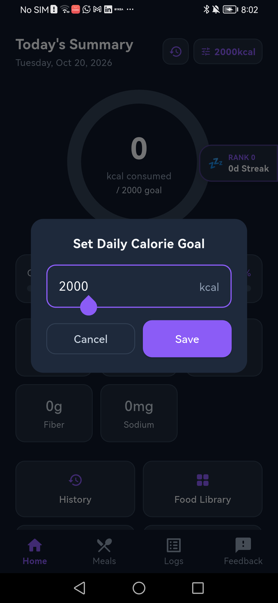
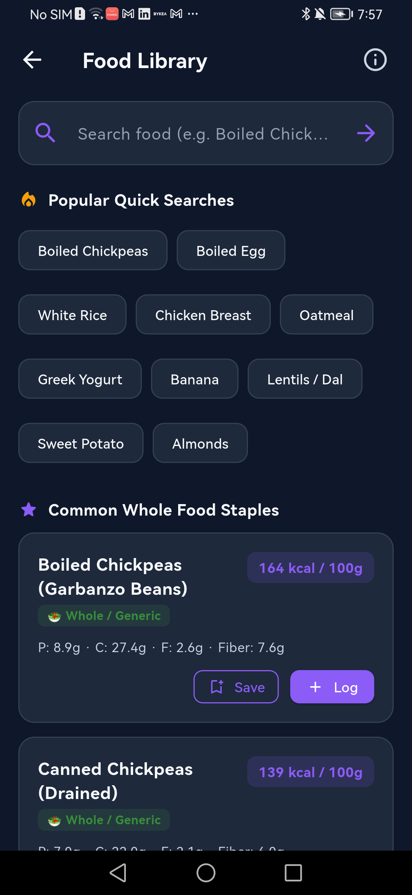
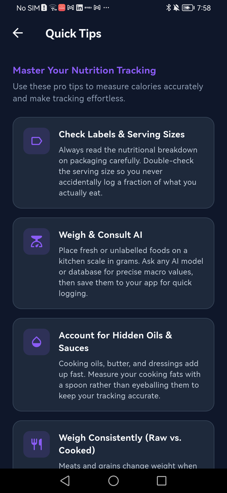
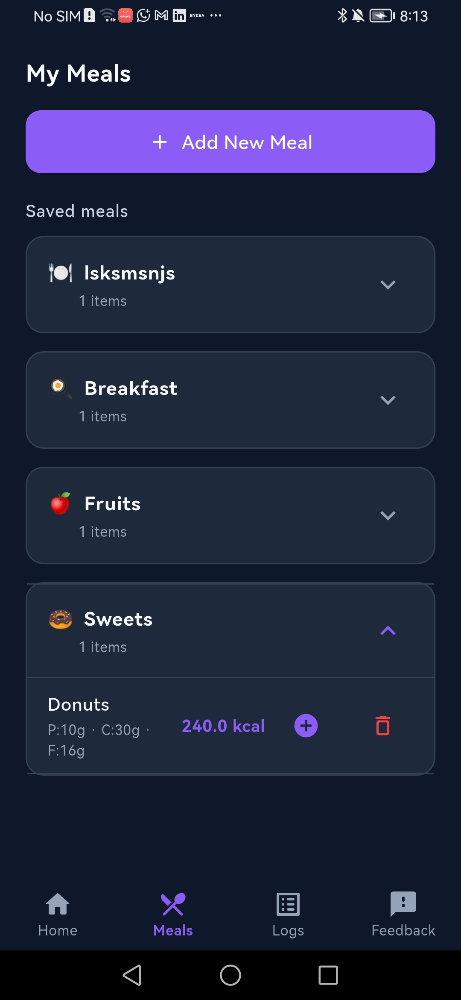

# Fit Lyfe | Smart Calorie & Nutrition Tracker 🥗📊

[](https://flutter.dev)
[](https://dart.dev)
[](https://developer.android.com)
[](LICENSE)

**Fit Lyfe** is a feature-rich, privacy-focused mobile application built with **Flutter** designed to make calorie tracking, macro budgeting, hydration monitoring, and consistency habit building effortless, engaging, and lightning-fast.

Whether your goal is to lose fat, build lean muscle, or maintain high daily energy, Fit Lyfe provides all the tools you need right on your device.

---

## ✨ Key Features

### 📊 1. Aesthetic Dashboard & Calorie Ring
- **Live Calorie Ring:** Real-time visual tracking of daily calories consumed, burned, and remaining against your goal.
- **Target Consistency Window:** Target indicator for hitting within **±100 kcal** of your daily goal to build discipline and maintain long-term streaks.
- **Comprehensive Macro Breakdown:** Track **Protein, Carbs, Fat, Net Carbs, Fiber, and Sodium** with colorful progress cards and ratio pills.
- **Smart Meal Grouping:** Logs automatically organize with smart emoji tags (Breakfast, Lunch, Dinner, Protein, Snacks, and Drinks).
- **Quick Logging Shortcuts:** Instantly log `+100`, `+250`, or `+500` kcal with a single tap.
- **Quick Log Dialog:** Fast manual meal entries with instant calorie calculation and macro distributions.

### 👑 2. 10-Tier Consistency Rank & Milestone Roadmap
- **Game-Inspired Progression:** Stay within ±100 kcal of your daily goal to climb through 10 progressive tiers:
  - Level 0: **Rookie** 💤
  - Level 1: **Starter** 🌱
  - Level 2: **Habit Builder** 🥉
  - Level 3: **Consistency Master** ⚡
  - Level 4: **Macro Alchemist** 🔥
  - Level 5: **Calorie Titan** 🛡️
  - Level 6: **Iron Will** ⚔️
  - Level 7: **Centurion Tracker** 🌟
  - Level 8: **Half-Year Legend** 💫
  - Level 9: **Fit Lyfe King** 👑
- **Interactive Side Badge:** Side-docked rank badge that neatly tucks to the screen edge showing only its emblem, and smoothly expands on tap or swipe.
- **Dedicated Rank Roadmap Screen:** Standalone view detailing your active tier, current streak count, requirements, and full tier roadmap.
- **24-Hour Streak Recovery:** Missed a day? Recover broken streaks within a 24-hour grace window via rewarded ads.

### 💧 3. Hydration & Water Intake Tracker
- **Quick-Cup Logging:** Add water with single-tap quick buttons (`+250ml`, `+500ml`).
- **Interactive Hydration Meter:** Track current fluid intake against a customizable daily hydration goal.
- **Aesthetic Audio Chimes:** Rewarding sound effects on tap and goal completion.

### 🏃 4. Workout & Burned Calorie Tracker
- **Activity Library:** Track Running, Cycling, Weight Training, HIIT, Swimming, Walking, Yoga, or custom workouts.
- **MET-Based Energy Expenditure:** Scientific estimation of burned calories factoring in duration, intensity, and body weight.
- **Net Calorie Balancing:** Displays total consumed calories, burned calories, and net remaining allowance.

### 🎯 5. Smart Goal Calculator
- **Guided Pathway:** Calculates Basal Metabolic Rate (BMR) and Total Daily Energy Expenditure (TDEE) via the Mifflin-St Jeor equation for weight loss deficits, maintenance, or surplus.
- **Manual Quick Target:** Set custom calorie numbers directly anytime.

### 🔔 6. Daily Reminders & Local Notifications
- **Scheduled Alarms:** Exact daily notifications for meal logging (default: 8:00 PM) and water hydration (default: 2:00 PM).
- **Time Customization:** Interactive time pickers directly in Settings to match your personal routine.
- **Exact Alarms & Boot Resilience:** Android 14+ exact alarm compatibility with boot receivers to preserve schedules across reboots.
- **Test Notification Action:** Instant test trigger in Settings to preview notification banners and sounds.
- **HD Branded Emblem:** Custom high-definition app logo for notifications.

### 📚 7. Food Library & Nutrition Database
- **Searchable Food Chart:** Browse and search everyday whole foods and recipes with exact macronutrient facts.
- **One-Tap Quick Logging:** Add library items directly to today's log in a single touch.

### 📅 8. Daily Archive & Nutrition History
- **"Done for the Day" Archiving:** Finalize your day to save your nutritional record and reset the active counters for tomorrow.
- **Comprehensive History Screen:** Review archived daily summaries, macro pill badges, water levels, and burned calories.
- **Aggregated Analytics:** View total logged days, average calorie intake, and average protein over time.
- **Persistent Undo:** Safely undo accidental daily resets within a 2-hour window.

### 🧭 9. Animated Guided Tour (Onboarding)
- **Interactive 9-Step Spotlight:** Dynamic spotlight cutout with smooth morphing animations and auto-scrolling to introduce every key area of the app.

### 🌐 10. Multilingual Support
- **Languages:** Full native translations in **English**, **Urdu (اردو)**, and **Arabic (العربية)**.
- **Right-to-Left (RTL):** Comprehensive RTL layout mirroring and localized date formatting.

### 🎨 11. Theme & Sound Customization
- **Themes:** OLED Dark, Crisp Light, and System Default.
- **Color Accents:** Aesthetic color palettes to match your style.
- **Custom Sound Effects:** Low-latency auditory feedback with in-app mute toggle.

---

## 📱 Screenshots

| Home Dashboard | Calorie Ring & Water | Consistency Ranks | Goal Calculator |
|:---:|:---:|:---:|:---:|
|  |  |  |  |

---

## 🛠️ Tech Stack & Architecture

- **Framework:** [Flutter](https://flutter.dev) (Dart SDK 3.x)
- **State Management:** `provider` for reactive themes, settings, and multilingual state.
- **Local Storage:** `shared_preferences` for offline-first persistence.
- **Notifications:** `flutter_local_notifications` + `timezone` + `flutter_timezone` with core library desugaring.
- **Sound Engine:** `audioplayers` for low-latency sound effects.
- **Monetization & Ads:** `google_mobile_ads` for banner ads and rewarded streak recovery.

---

## 🚀 Getting Started

### Prerequisites
- [Flutter SDK](https://docs.flutter.dev/get-started/install) installed and added to your `PATH`.
- Android Studio / VS Code with Flutter extensions.
- Android SDK with Java 17+.

### Installation & Run

1. **Clone the repository:**
   ```bash
   git clone https://github.com/Bilawal13/FitLyfe---Calorie-Tracker-App.git
   cd FitLyfe---Calorie-Tracker-App
   ```

2. **Install dependencies:**
   ```bash
   flutter pub get
   ```

3. **Run on a connected device / emulator:**
   ```bash
   # Run standard
   flutter run

   # Or optionally with USDA API key define:
   flutter run --dart-define=USDA_API_KEY=your_actual_api_key_here
   ```

4. **Build Release Android App Bundle (.aab):**
   ```bash
   flutter build appbundle --release
   ```
   The generated bundle will be located at:
   `build/app/outputs/bundle/release/app-release.aab`

---

## 🔒 Security & Privacy

- **Offline-First & Private:** All logs, custom foods, hydration stats, and streaks are stored strictly on your local device.
- **Zero Secret Leakage:** Signing keystores (`upload-keystore.jks`), credentials, properties files (`key.properties`), and environment secrets are protected and ignored by `.gitignore`.

---

## 📄 License

This project is licensed under the MIT License — see the [LICENSE](LICENSE) file for details.
